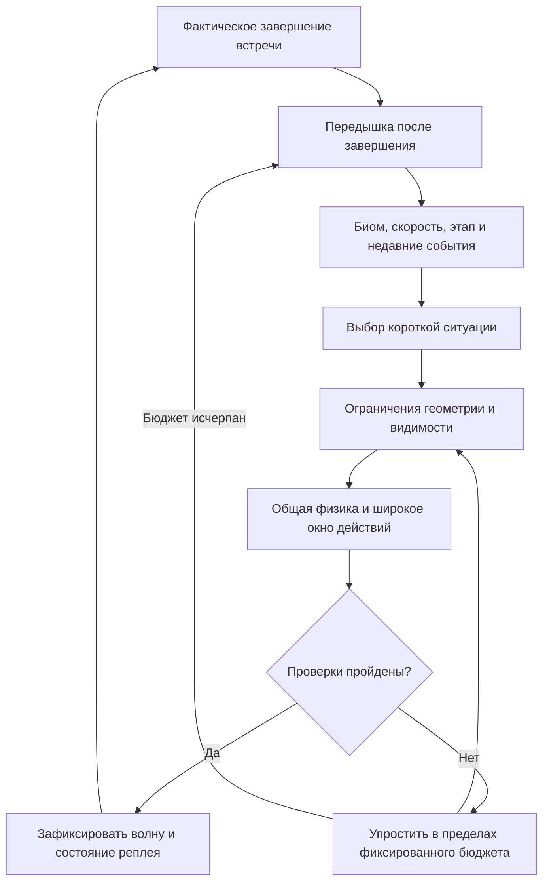

# Генератор препятствий: интерес, читаемость и воздушные встречи

23 октября 2026. Исследование и техническое задание для реализации Sol.
Проверенная база: опубликованная **4.5.0**, remote main `44579d2e5d44a5aec3d4f76192d2e2a145b71db7`, чистый checkout `/tmp/tesla-audio-v450-20261023`. Грязная рабочая папка содержит более старый runtime и чужие изменения: её нельзя использовать как источник нового релиза.

## Результат для игрока

Летающие враги действительно находятся в воздухе. На земле можно безопасно проехать под отдельной воздушной встречей. На некоторых рампах враг предлагает понятный выбор: изменить момент захода/прыжка или спокойно пропустить скольжение. Скорость добавляет напряжения, но не сокращает требуемые окна до машинной точности. Длинных поездов Tesla и обязательного расходования топлива для выживания больше нет. У игры остаются трюки, скорость, риск ради очков, характер биомов и передышки.

Это настройка генерации, её проверок и совместимости реплеев. Не менять физику прыжка/вращения, управление, текущую камеру, начисление очков, музыку, арт или правила смены биомов без доказанной необходимости. Использовать имеющиеся спрайты; рисование новых ассетов не требуется.

## Что показал аудит текущего кода

| Находка | Доказательство в 4.5.0 | Последствие |
| --- | --- | --- |
| Все 7 летунов стали низкими препятствиями | `content.js`: altitude=32; `director.js`: первые два=24, затем=32; все сталкиваются с прямостоящим героем на земле | Воздушный противник по роли почти наземная машина |
| Поезд из 6 Tesla реален | `routes.js`, `thrust`: 4–6 машин, шаг165, ширина110, зазор55; при speed510–1373.75 шесть машин занимают935 единиц | Очень тесная последовательность; скорость делает промежутки ещё короче |
| Свидетель маршрута не означает удобство | `validateRoute`: первый успех; обычная проверка только lead±35мс с общей политикой на все прыжки | Нет измерения непрерывного окна, независимой ошибки второго прыжка и места для трюков |
| Поиск предпочитает топливо раньше простого заряда | Один truck, speed360/fuel100: первый свидетель charge0/burn.35 (28 топлива); при запрете thrust есть charge.5/burn0 | Генератор может признать топливо необходимым, хотя есть простой бесплатный маршрут |
| Передышка считается от спавна | `S.next` уменьшается, пока препятствия ещё впереди; ожидание освобождения проверяется отдельно | Значение2.3 не гарантирует2.3 секунды отдыха после завершения задачи |
| Биомы уже фильтруются | `director.js` учитывает eligible ground/air; завод имеет явный список | Не объявлять старую проблему общих пулов нерешённой; сохранить и распространить фильтр на новые шаблоны |
| Рампы и враги пока взаимоисключены | Рампа создаётся отдельно; наличие рампы запрещает новый spawn; `validateRailRoute` не проверяет врагов | Просто поднять altitude недостаточно для корректной встречи на рампе |
| Проверки скорости неполны | speed=base×(1+streak)×(1+boost)+vx; 660×1.25×1.35=1113.75, плюс ограниченный vx до260 | Тест только825 не покрывает сочетание ускорителей; достижимость крайних состояний проверять отдельно |
| Дальний spawn не равен ранней видимости | На390px при1113.75 и approach110 расчёт от первого появления на правой границе даёт≈0.836с | Полностью видимый силуэт и подготовка оставляют ещё меньше времени; нельзя лечить это только dx |
| Поиск выполняется синхронно | До3×12×4=144 политик, по1440 тиков, плюс рекурсивные проверки margin | Не раздувать brute force и не повторять его на каждом кадре |

Воспроизводимая выборка: `../verification/2026-10-23-director-audit/audit.mjs` и `audit.json`. Матрица синтетических состояний; это не вероятность выживания игрока. Разовые времена на рабочем компьютере ≈2–21мс не являются p95 и не доказывают скорость на телефоне. Расчёт видимости использует установившуюся камеру; переходная камера требует отдельной проверки.

### Контрольные забеги исходной версии

Четыре seed17/932/2026/42 по240 игровых секунд, действия из route.actions, без человеческого ввода: все завершили интервал живыми, 62–63 волны, максимум3 объекта в наблюдавшихся волнах. Это не опровергает train6: такой шаблон требует fuel≥65, а выбранная политика почти не пополняет его трюками. Максимальная наблюдённая скорость816.55–891, поэтому этот набор сам по себе не покрывает сочетание1113.75+vx. p95 полного шага со спавном11.06–15.38мс, максимум21.19–29.26мс на этом компьютере; это4 небольшие выборки без CPU throttle, не телефонный benchmark. Минимальный промежуток между освобождением текущих объектов/рампы и следующим spawn — один tick(8.33мс). До следующего действия ещё остаётся путь нового объекта: этот результат доказывает отсутствие гарантированной post-clear паузы, а не8мс на реакцию. Полные исходные результаты в baseline-runs.json.

## Референсы и выбор алгоритма

1. **Canabalt, оригинальный Sequence.m, Semi Secret Software.** Генерация размеров зависит от скорости; опасные типы отбрасываются при неподходящей геометрии. Берём зависимость от движения и ограниченный безопасный fallback. Код не копируем. [Исходник, reset / строки393–444](https://raw.githubusercontent.com/ericjohnson/canabalt-ios/master/src/Sequence.m).
2. **Gillian Smith, Tanagra / Launchpad, 2012.** Ритмические группы действий, геометрические ограничения и оценка разнообразия генератора. Берём шаблоны с контрактом входа/выхода и отдельную проверку разнообразия. Не переносим большой constraint solver в браузер. [Диссертация, главы3–5 и7](https://escholarship.org/content/qt0fn558gq/qt0fn558gq.pdf).
3. **Michael Booth, Valve, AI Systems of Left 4 Dead, 2009.** Чередование нагрузки и отдыха; отдых начинается после окончания текущего столкновения. Берём принцип темпа, а не длительности/боевые параметры чужого жанра. [Слайды77–81](https://cdn.akamai.steamstatic.com/apps/valve/2009/ai_systems_of_l4d_mike_booth.pdf).
4. **SYBO / Unity, Subway Surfers City, 24 марта2026.** Самостоятельные сегменты с правилами вариаций и быстрым просмотром конкретных встреч. Берём небольшую библиотеку ситуаций и адресные воспроизводимые сценарии. Не переносим Unity/Addressables в Canvas. [Материал команды](https://unity.com/resources/sybo-subway-surfers-city).

Сравнение вариантов: независимый random по объектам дешёв, но плохо контролирует сочетания; безграничный поиск физически допустимого маршрута дорог и не оценивает удобство; полный WFC/обучаемый директор здесь избыточен и усложняет реплеи. Выбор: **небольшая грамматика ситуаций + временные ограничения + ограниченная проверка общей физикой + директор ритма**. Ни один источник не доказывает, что конкретные числа ниже уже приятны: это начальная настройка для проверки.

## Алгоритм

### 1. Выбирать ситуацию, затем геометрию

Библиотека первого выпуска:

| Шаблон | Роль | Обязательный безопасный путь |
| --- | --- | --- |
| `single` | Один знакомый наземный объект | Один обычный прыжок без thrust |
| `spaced-pair` | Два разных/согласованных объекта | Два прыжка с реальной паузой на земле |
| `low-cluster` | Редкая компактная группа | Не более2 машин в одной дуге, затем свободное приземление |
| `rail` | Свободное скольжение и трюк | Проезд по земле или удобный заход на рампу |
| `air-pass` | Воздушное напряжение | Не нажимая ничего, проехать под врагом; прыжок остаётся добровольным риском |
| `rail-air` | Редкая вариация скольжения | Безопасный низ + проверяемый вариант скольжения с изменением тайминга/прыжком |
| `rest` | Время осмотреться и подготовиться | Настоящий пустой интервал после окончания предыдущей ситуации |

Удалить `thrust` как обязательный survival-шаблон. В первой настройке максимум2 наземных объекта в ситуации, не более2 тесно стоящих машин. `low-cluster` не является лазейкой для цепочки таких групп: после неё обязательный rest. Вектор разнообразия — типы врагов, разные ритмы, скольжение и воздушный выбор, а не число машин.

Контракт шаблона: ID, разрешённые биомы, допустимый диапазон сложности, число обязательных действий, стоимость нагрузки, минимальное время подготовки, безопасный выход, cooldown и список проверяемых политик. Размеры брать из канонического `content.js`, не масштабировать автомобили в крошечные препятствия ради успешного solver.

### 2. Измерять расстояния временем

Для пары задавать **время свободного стояния после приземления**, а не только расстояние между началами объектов. Начальные цели: ≥0.45с до следующего обязательного hold; для первого знакомства ≥0.65с. Учитывать charge duration дополнительно.

Геометрию оценивать через D(T)=integral(v_player(t)+v_enemy(t))dt с ширинами столкновений и запасом. Постоянное v×T допустимо только как консервативная оценка с последующей проверкой. Брать текущий boost/streak, их развитие/истечение, vx и восстановление. После появления не телепортировать, не двигать препятствия в ответ на нажатия, не менять их коллизию незаметно.

Видимость — отдельный допуск: считать от появления **полного силуэта** до первого требуемого действия. Цель ≥0.9с; предпочтительно ≥1.1с для нового/воздушного сценария. Для очень высокой скорости запрещать сложные обязательные сочетания; оставлять низкий single или добровольный air-pass с безопасным no-input. Не уменьшать временные окна ради роста сложности. Политику генерации сделать одинаковой для реплея и всех экранов: консервативный канонический телефонный envelope, проверенный на320/390/844/1440. Не зависеть от текущего DOM/размера окна или времени CPU. Учесть худший лаг камеры при ускорении и отдельно состояние входа в кадр.

### 3. Настоящие воздушные роли

Нижняя кромка любого обычного летуна должна быть выше полного upright ground hull163 плюс запас: стартовый ориентир≥205. Это реальная высота collision и рисунка. Отдельные диапазоны/скорости для малого дрона, птицы, Starlink и большого Sikorsky. Размер176×89 у вертолёта не позволяет механически использовать правила76×41 для skull. Проверять силуэт в кадре; крупный вертолёт не обязан участвовать в rail-air.

`air-pass`: один летун, чистая земля, no-input witness; не совмещать с обязательным прыжком через наземное препятствие. Враг имеет настоящую box-коллизию в воздухе, не притворяется безопасным декором.

`rail-air`: один небольшой летун, чистая земля под всей встречей. Из той же исходной точки проверять (a) безопасный отказ от рампы без топлива, (b) реальное скольжение с безопасным завершением — поздний заход после пролёта или удобный прыжок с рампы. Сохранять запас на приземление и не ловить героя на выходе. Отказ от рампы не должен быть единственным допустимым решением, иначе рампа превращается в ловушку. При высокой скорости/короткой рампе/плохой видимости деградировать в обычную рампу или свободный air-pass. Не обещать mid-rail hop на нынешней рампе720, пока общая симуляция не докажет окна; не удлинять её незаметно для проталкивания проверки. Первая и вторая рампы свободны. Первые два воздушных знакомства — отдельные air-pass. Затем rail-air не чаще каждой третьей подходящей рампы и не чаще1 раза в30с. Нужен тест, доказывающий, что rail-air действительно появляется при подходящих условиях, а не всегда скрывается fallback.

### 4. Биомы и прогрессия

Сохранить `biomeAt(score)` и существующий7000-point cycle. Смена биома не должна зависеть от новой случайной ветки или перезапускать общий прогресс. В новую волну включать только врагов её биома. Не менять уже появившихся врагов при смене score leg. Первые8с нового leg — знакомые простые ситуации; затем представить нового врага отдельно. Во время визуального перехода отбирать содержимое по детерминированному состоянию leg/дистанции, без чтения renderer; не запускать rail-air на границе.

Космопорт: нынешние spaceport-only плюс общие. Завод: нынешний ground whitelist (`truck,t800,bydSeal,xiaomiSu7,batteryAgv,xi`) и factory-eligible летуны; qualitySkull только завод, bird/Starlink/Sikorsky только космопорт. Новые назначения биомов не выдумывать.

Рост по активному `pace.progress`, а не по умению быстро набрать очки:

| Этап | Что добавляется |
| --- | --- |
| 0–35с | single и знакомство со свободной рампой; без воздушных конфликтов |
| 35–90с | редкая spaced-pair, свободные рампы, отдых |
| 90–150с | первый отдельный air-pass после выполненных условий знакомства |
| 150с+ | дозированные rail-air, больше вариаций существующих ситуаций |

Это стартовые пороги, допускается корректировка Sol по измерениям с записью причины. На быстрых boost/streak комбинациях сложность структуры **снижается**, потому что скорость уже создаёт нагрузку. Не карать за хороший трюк: multiplier/score не должны автоматически увеличивать плотность.

### 5. Ритм и защита от повторений

Простой сериализуемый цикл `introduce -> flow -> accent -> rest`. В flow2–3 лёгкие ситуации; accent максимум1 составная ситуация; после неё отдых. Рандомизировать безопасные варианты в пределах фазы, а не сам факт отдыха. Не более2 волн с одним наземным ID подряд и без немедленного повторения сложного шаблона; маленький history ring/weighted bag, затем детерминированный fallback при пустом пуле.

Считать `restUntil` от **фактического завершения**: герой на земле, нет support/падения/восстановления, угрозы прошли безопасную границу. Пауза после accent/rail-air ≥1.25с; регулярный настоящий rest≥1.0с, начальная цель1.5–2.0с. Не расходовать отдых во время полёта или подхода препятствий. После падения/спасения BACKUP — восстановление и2 простые волны; никаких бонусных врагов. Состояние сохранять в snapshot/checkpoint; адаптация только к событиям общей симуляции. Не пытаться оценивать человеческие эмоции/личное мастерство по внешним данным.

### 6. Проверять удобство, а не один идеальный ответ

Сначала аналитические ограничения: biome, число объектов, интервалы, высота, полоса безопасного прохода, бюджет нагрузки, видимость. Затем ограниченные политики на общей production physics. Сначала **все простые zero-thrust политики**, а не thrust до более подходящего заряда. Fuel/щит/сердце не должны быть условием выживания в обязательной ситуации.

Допуск обычного сценария: безопасная посадка, реальный запас до следующего hold и одно непрерывное sampled окно по release lead шириной≥0.18с (стартовая цель0.24с), с шагом≤0.03с. Проверять внутренние точки, не только края. Для пары возмущать тайминг второго прыжка независимо; для rail-air — заход и выход. Заряд: соседние значения±0.1 с учётом0..1; целевые критические комбинации проверить offline. Если широкий допуск не найден — упрощать ситуацию, а не снижать margin. Само это окно не доказывает удовольствие или процент успеха людей.

Совмещённую рампу и врага проверять в одной симуляции с `advanceRail` и `sweptCollision`; две независимые проверки маршрутов не доказывают совместимость. Учитывать реальные порядок шага, посадочные rewards/скорость, jump booster, выгорание boost, вращающийся hull и обе координатные системы. Не писать второй упрощённый физический движок. Сохранить route.actions для воспроизводимого общего run harness; проверять их именно в `createRun`.

### 7. Производительность и границы модулей

Переиспользовать `content`, `director`, `routes`, `rails`, `run`. Небольшой чистый config/policy модуль оправдан, если он скрывает ограничения/шаблоны; не строить универсальный генератор и не дробить код ради схемы. Сначала измерить текущую генерацию и главный источник затрат.

На runtime: максимум3 кандидата за выбор +1 безопасный fallback; фиксированный бюджет simulation ticks/policies, отсутствие рекурсивного разрастания. После исчерпания бюджета — rest и безопасный retry на следующем запланированном событии, не busy loop. Большую сетку состояний/зарядов/ошибок гонять в скрипте проверки, runtime только компактные необходимые свидетели и защитные допуски. Кэш допустим для неизменных geometry/config либо подсказок политик; чужой округлённый state не является доказательством безопасности для текущего fuel/boost/streak. Если нужна порционная работа, её порядок/бюджет определяется simulation ticks и попадает в checkpoint; не wall-clock таймаутом, Worker race или performance.now().

Профиль: warm/cold p50/p95/max, число кандидатов/симуляционных шагов, fallback rate, на одинаковом Node/Chromium и seed set до/после. Цель p95 генерации≤4мс на текущем компьютере, не более одного frame budget пиков; не выдавать её за телефонный SLA. При превышении сократить пространство поиска/подобрать политики до runtime. Отдельно профилировать server replay: новый генератор запускается и там. Не ослаблять replay для скорости.

## Приёмка и работа Sol

1. Работать от свежего remote main в изолированном checkout; сначала прочитать AGENTS/HANDOFF/RESTORATION и подходящие `ponytail`/`superpowers-engineering`. Снимок и ограниченный tested rollback. Сохранить4.5.0 audio/camera/rare BACKUP/rails и чужие файлы.
2. Исправить явно устаревший тест «every flying model is a grounded-player collision hazard» на новый контракт; сохранить этот старый контракт **в старых frozen rulesets**. Не править старую историю ради зелёного теста.
3. Матрица: оба биома, пороги stages/legs±tick, fuel0/20/50/100, скорости360/510/660/825/1113.75 плюс достижимый vx, boost start/end/jump pickup, recovery/heart rescue, размеры320/390/844/1440. Все7 air моделей с корректными профилями; factory exclusivity сохраняется.
4. Проверить ground underpass, реальное rail-air + альтернативный rail route, отсутствие train>2, непрерывные timing windows, независимую ошибку второй команды, фактические паузы, cooldown и разнообразие. Не засчитывать forced fixture за доказательство частоты в обычной генерации.
5. Много seed: дешёвые structural проверки≥1000 seed; полноценные воспроизводимые runs для ограниченной набора seed/профилей, покрывающего≥2 переходов биома и≥10мин игрового времени на сценарий при возможности. Отдельно вариант imperfect actions; отчёт по проигрышам/отказам, а не только лучшим проходам. Остановиться и объяснить любой объём, который оказался слишком дорогим, не сокращать молча.
6. Детерминированность: повторный seed+events, JSON checkpoint до/во время составной встречи, chunk replay, old/current/outbox. Показать минимум один естественный заход на каждую новую ситуацию. Снимки/короткая запись реального рендера rail-air на телефоном размере и native input; эмуляция не равна проверке iPhone.
7. `npm test`, `npm run check`, meaningful focused tests, browser validation, replay/server checks, performance report. Новая generation/collision семантика требует нового immutable ruleset, additive allowlist/migration/bundles; все8 старых rulesets byte-identical, реальные/отложенные рекорды сохранены. Не выпускать frontend с неподдерживаемым backend ruleset.
8. Обновить `docs/gameplay-v3.md`, `docs/content.md`, `docs/HANDOFF.md`, `RESTORATION.md`, текущий документ и evidence. Отдельно указать реализованные настройки, измерения, неосуществлённые варианты и субъективную приёмку. После необходимых проверок публикация разрешена standing AGENTS: актуальный remote recheck, ограниченные коммиты, backend compatibility, Pages success и live hashes, одна versioned публичная ссылка.

Открытые решения закрываются реализацией/измерениями: конкретные высоты/скорости по модели, ранний jump или поздний catch для rail-air, способ ограничения runtime search. Они не требуют повторного общего согласования пользователя. Если красивый вариант не проходит ограничения, выбрать более простой, описать причину и сохранить основную задачу: настоящие воздушные враги, нескучный доступный генератор.

## Проверенный техдолг и границы доказательств

Биомная фильтрация уже существует. Подтверждённые проблемы для этого этапа: низкие летуны, длинный thrust train, удобство маршрута, fuel-first search, реальная длительность отдыха, неполный speed envelope и стоимость поиска. Старые вопросы PWA closed-tab update, независимого daylight и физического iPhone input не решаются этой задачей. После выпуска разумный ограниченный этап — реальные телефонные event→step→render замеры и один playtest набора rail-air/boost; не начинать его без отдельной задачи. Машинная проходимость и красивый график не заменяют человеческую оценку интереса.

## Реализация и калибровка Sol —24 октября2026

Реализовано в изолированном `/tmp/tesla-director-v460-20261023`, поверх4.5.0/44579d2. Канонический контракт — начало `docs/gameplay-v3.md`, измерения — `docs/verification/2026-10-23-director/`. Сохраняются физика, score cycle, камера, аудио, исходные размеры, все8старых rulesets и чужой dirty root.

Уточнения по измерениям: .9/.8s относится к ordinary nominal/early-error samples; изолированная высокая категория имеет .74/.64s, Rogozin .72/.62s, с неизменным180ms окном и joint±.1charge corners. Иначе любимые Xi/T800 и реакции исчезали. У ordinary ground ±.1charge проверяется при nominal lead; дополнительные jointcorners —±.05charge/±.06s. Это не прямоугольный допуск±.1×±.09 для каждой низкой машины. Калибровка low-charge с учётом120Hz устраняет доказанный20–37s early fallback gap; отдельная регрессия требует работающий V8/Truck при360–660 и отсутствие пустого>12s без deliberate boosts/recovery.

Консервативный sight envelope уточнён по непрерывной ширине: worst breakpoint≈1002.11px, а не автоматически320px. Rail-air использует поздний вход, не mid-rail hop. Пока третья подходящая рампа ждёт общего air cooldown, отдельный air-pass уступает ей подход. Runtime reuse — точный общий idle-prefix, начинающийся до самого раннего charge+.1/lead+.09; full/prefix эквивалентность проверена.

Производительность: цель4ms — ориентир, не достигнутое обещание и не телефонныйSLA. Сопоставимые4seed×240s Node/Chromium отчёты сохраняют p50/p95/max, а большой regression matrix отдельно фиксирует spikes. Субъективная интересность и физический iPhone остаются открытой приёмкой. После выпуска предлагается ограниченный этап реального phone event→step→render и одного playtest rail-air/boost; он не начат этой задачей.

## Исправление фактической пустоты4.6.3,24октября

После публикации обнаружена критическая ошибка: repeated flips соstreak давали0–1волнуза240s. Renderer снимал приближение отeffective speed, validator ошибочно отbase; затем speed>760навсегда запрещалground, аair/railждалиground progress. Поправка отслеживаетactualdampedcamera, first-full-silhouette timing, exactlandingtick и clear-trackrest. Новый fast-single профиль.85/.75s сохраняет.18s окно; обычный.9/.8 иtallпрофилинеослаблены. Приgroundfail возникаетoptionalplainrail, анепостояннаяпустота. Четыре observational300sзабега безroute.actions дают59–60волн,maxgap7.62s, rails18–20%; imperfect107flips/18fall/43waves,maxactivegap11.36s. Independent nativeofflinePWA180s:34waves/85flips/alive. См.docs/verification/2026-10-24-director-liveness/.
